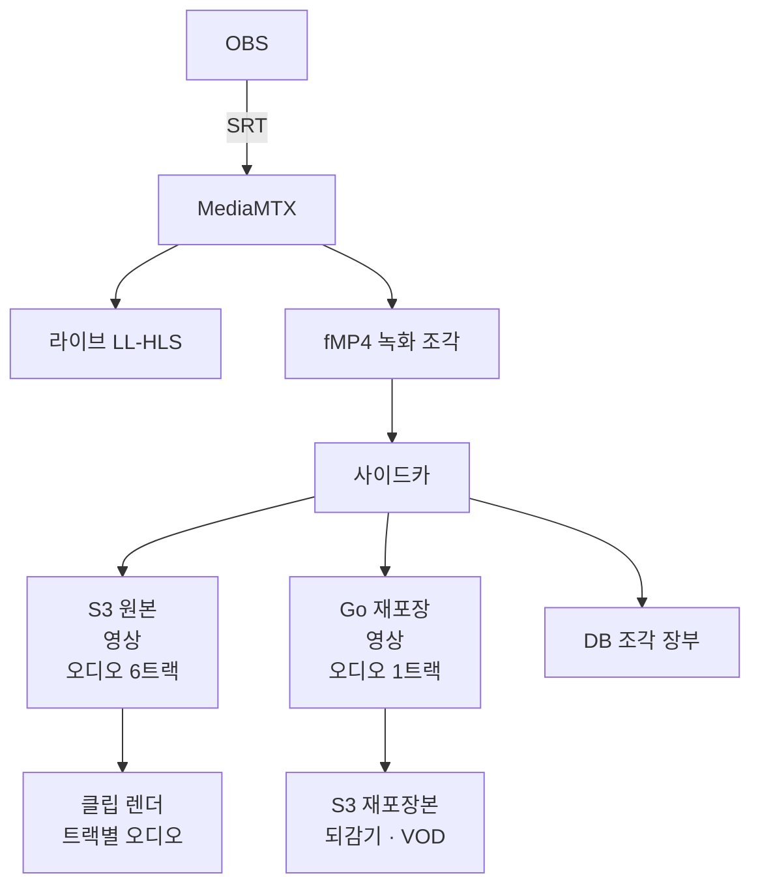

PokeClip의 「조각마다 찍힌 시각」 설계를 여섯 번 고쳤습니다. 한 결함을 막으면 옆에서 다른 결함이 나왔습니다. 플레이어가 본 장면과 클립의 시작 프레임을 맞추려던 일이, 영상·오디오마다 다른 시각 보정과 재접속 뒤의 보정 상태까지 관리하는 문제로 커졌습니다.

결국 질문을 바꿨습니다. **파일 안에 이미 프레임의 시각이 있는데, 왜 서버가 짐작한 벽시각(현실의 날짜·시각)을 거쳐 자를 자리를 정해야 할까요?**

2026년 11월 2일, 저는 두 가지를 결정했습니다. 클립·편집·렌더(최종 영상 생성)의 정밀 좌표는 미디어 시각(파일 안의 위치를 나타내는 시간)으로 옮깁니다. 벽시각을 조금씩 따라가는 학습형 보정은 없애고, 한 구간 안에서는 미디어 시각을 누적하다 차이가 커지면 새 기준을 잡습니다. **새 설계는 아직 구현하지 않았습니다.** 이 글은 성능 개선 결과가 아니라 선택지와 비용을 남기는 설계 결정 기록입니다.

결정은 제가 했습니다. 레퍼런스 수집과 평가는 제 지시로 서로 다른 AI 에이전트(Claude Code)가 나눠 맡았습니다. 평가 에이전트는 인용 URL 33개를 다시 열고 인용 69문장을 원문과 대조했습니다. 아래 실측 함정도 Claude Code 에이전트가 수행·기록한 프로젝트 실측 보고서에서 가져왔고, 저는 그 결과를 판단에 썼습니다. 이 글 본문 초안은 AI(Codex)가 제 재료를 바탕으로 썼습니다. 대표 이미지는 ChatGPT 이미지 생성으로, 설명 영상은 Claude Code가 Remotion으로 만들었습니다.

## 영상은 두 경로로 지나가고, 시계는 두 개입니다

PokeClip은 방송을 받아 하이라이트를 만들고, 방송 중 되감기와 방송 후 다시보기를 제공합니다. HLS(영상을 조각과 재생목록으로 전달하는 방식)는 라이브와 녹화 재생에 모두 쓰지만, 두 경로의 생산자는 다릅니다.

OBS(방송 송출 프로그램)가 SRT(네트워크 손실 복구를 지원하는 영상 전송 프로토콜)로 보낸 입력을 MediaMTX(스트리밍 수신·중계 서버)가 받습니다. 여기서 라이브와 녹화가 갈라집니다. 녹화 파일은 사이드카(녹화기 옆에서 파일을 처리하는 프로세스)가 읽어 업로드하고, 조각마다 메타데이터 한 줄을 DB 장부에 씁니다.

라이브는 LL-HLS(조각보다 작은 단위도 전송해 지연을 줄이는 HLS)입니다. 녹화는 fMP4(분할해서 기록할 수 있는 MP4)입니다. 조각 길이는 4초를 목표로 설정했지만 고정 길이는 아닙니다. 프로젝트의 OBS 실송출 시험에서는 인코더(영상을 압축하는 프로그램)의 키프레임(독립적으로 복원할 수 있는 프레임) 간격에 따라 약 5.7초 조각도 나왔습니다. 뒤에서 길이를 누적할 때는 설정값이 아니라 실제 미디어 길이를 써야 합니다.[16](#출처)

원본은 영상과 오디오 6트랙(서로 분리된 음성 흐름)을 보존합니다. 클립 렌더와 트랙별 오디오에 씁니다. 재포장본은 오디오 한 트랙을 골라 되감기와 VOD(Video on Demand, 방송 후 다시보기)에 씁니다. 이는 이 프로젝트의 재생 경로 선택입니다. HLS 자체가 대체 오디오를 지원하지 않는다는 뜻은 아닙니다.[1](https://www.ietf.org/archive/id/draft-pantos-hls-rfc8216bis-22.txt)

### 조각에 붙은 두 시계는 답하는 질문이 다릅니다

벽시각(달력과 시계가 가리키는 실제 시각)과 미디어 시각(영상 안에서 센 시간)은 같은 장면을 다른 방식으로 가리킵니다. 파일에는 표본(프레임처럼 시간값이 붙는 미디어 단위)의 타임스탬프(시각을 나타내는 값)가 기록돼 있습니다.[각주 1](#1-벽시각과-미디어-시각)

| 비교 기준 | 벽시각 PDT | 미디어 시각 |
| --- | --- | --- |
| 답하는 질문 | 이 장면은 몇 시 방송인가 | 이 파일의 어느 표본인가 |
| 표현 예시 | 21:03:05.120 | 특정 조각 안 2.5초 지점 |
| 값의 원천 | 현재 입력에서는 수신 서버의 추정 | 파일에 기록된 정수 타임스탬프와 시간 단위 |
| 정밀 좌표로 쓸 때 | 추정 오차와 시계 재설정을 함께 다뤄야 함 | 표본을 특정할 수 있지만 트랙·원점 변환은 필요 |

PDT(Program Date Time)는 HLS의 `EXT-X-PROGRAM-DATE-TIME` 태그로 표현하는 절대 시각 대응입니다. HLS 개정 초안은 이를 조각의 첫 표본과 연결합니다. 다만 시각이 소수점 아래까지 적혀 있다고 캡처 순간까지 그 정밀도로 안다는 뜻은 아닙니다.[1](https://www.ietf.org/archive/id/draft-pantos-hls-rfc8216bis-22.txt)

수집 당시 OBS 소스에서 일반 SRT 출력에 송신 측 벽시각을 넣는 경로는 확인되지 않았습니다. 벽시각을 영상에 싣는 BPM(방송 성능 측정 메타데이터) 주입은 멀티트랙 영상 출력과 MP4 출력에서 확인됐습니다. 따라서 현재 경로는 송신자가 준 캡처 시각 대신 MediaMTX의 추정을 사용합니다. 모든 SRT 응용이 벽시각을 전달할 수 없다는 뜻은 아닙니다.[5](https://github.com/obsproject/obs-studio/pull/11004)

MediaMTX 추정기는 처음 받은 시각을 기준으로 미디어 시각을 더합니다. 계산값이 현재보다 미래이거나 5초 넘게 과거이면 기준을 다시 잡습니다. 트랙마다 추정기가 따로 있습니다. 이 동작은 조사에 사용한 2026년 11월 1일 소스 커밋 `847a6ee` 기준입니다.[4](https://github.com/bluenviron/mediamtx/blob/847a6ee/internal/ntpestimator/estimator.go)

### 벽시각을 없애려는 것은 아닙니다

벽시각은 여전히 필요합니다. 라이브에서 되감기로 넘어갈 때 같은 장면을 찾고, 채팅과 마크를 장면에 연결하고, 화면에 방송 시각을 표시합니다. 라이브에서 되감기로 넘길 때의 허용 오차는 프로젝트 기준으로 ±0.25초입니다. 업계 공통 기준으로 가져온 값은 아닙니다.

바꾸려는 것은 클립·편집·렌더까지 이 벽시각을 정밀 좌표로 쓰던 부분입니다. 「몇 시 장면인가」와 「어느 프레임을 자를 것인가」를 같은 값 하나에 맡겼습니다.

## 보정식을 고칠수록 경계가 늘어났습니다

### 실측에서 나온 함정

아래 수치는 AI 에이전트가 수행한 2026년 11월 2일의 프로젝트 실측 보고서에 남아 있는 관측입니다. 새 설계를 적용한 결과가 아닙니다. OBS 시험은 32.2.2의 루프백(같은 컴퓨터 안에서 보내고 받는) 송출로, 1080p·30fps(초당 30프레임) 영상과 무음 오디오 6트랙을 사용했습니다. x264(H.264 소프트웨어 인코더)와 VideoToolbox(macOS의 인코딩 프레임워크)를 각각 70초씩 8회 연결했습니다. 실제 인터넷 송출과 새 인코더의 첫 접속까지 대표하지는 않습니다.[16](#출처)

- **트랙마다 추정 기준이 달랐습니다.** B 프레임(앞뒤 프레임을 참고해 압축하는 프레임)을 켠 OBS 시험에서 영상과 오디오의 기준 시각 차이는 접속별 중앙값으로 약 94ms였습니다. B 프레임은 디코드 순서와 표시 순서를 다르게 만듭니다.[각주 2](#2-디코드-순서와-표시-순서)
- **조각마다 기준이 되는 트랙이 바뀌었습니다.** 조각 시작의 시각을 제공하는 트랙이 영상과 오디오 사이에서 바뀌며, 이웃 조각의 시각 증가량에 약 ±105ms의 톱니 모양 변동이 생겼습니다. 이는 캡처 시각에 대한 절대 오차 상한이 아니라 조각 사이의 변동입니다.
- **첫 조각만 시간 관계가 달랐습니다.** 첫 영상 표본의 구성 시차(표시 시각과 디코드 시각의 차이)는 시험에서 녹화기가 새로 시작한 경우마다 그 첫 조각에서 0이었습니다. 이후에는 합성 시험에서 약 33.3ms, OBS 시험에서 약 66.7ms였습니다. 30fps 기준 한두 프레임 차이입니다.[각주 2](#2-디코드-순서와-표시-순서)
- **시간 도약 뒤에는 장부가 겹쳤습니다.** 패킷 도착은 계속되는데 미디어 타임스탬프만 6초 앞으로 옮긴 합성 입력에서 녹화기가 재시작했습니다. 앞 조각의 장부상 끝과 다음 녹화의 추정 시작이 2,575ms, 약 2.6초 겹쳤습니다. 일반적인 재접속의 평균값은 아닙니다.
- **추정기의 재설정과 녹화기의 재시작이 같지 않았습니다.** 미디어 시계를 0.96–0.98배로 늦춘 합성 송출기를 가상 머신의 녹화기(위 시험과 같은 이미지)에 붙인 시험에서는, 네 번 모두 접속의 첫 약 +5초 재설정이 한 녹화기 표식 안에 남았습니다. 실제 송출기의 시계 오차보다 훨씬 큰 조건입니다. 시각이 계단처럼 바뀌었다는 이유만으로 새 녹화라고 판정할 수 없었습니다.
- **렌더 단계에는 벽시각 설계와 별개인 오차도 있었습니다.** FFmpeg(영상 변환 도구) 7.1.5에서는 시각을 옮기는 `setpts` 뒤에 프레임을 덧대는 `tpad`를 놓으면 같은 시각의 프레임 복제가 끝나지 않았습니다. 8.0.1 기본값에서는 재현되지 않았습니다. 별도로 MP4 편집 목록의 시간 단위 때문에 출력 영상 시각이 약 1.3ms 당겨지는 경우도 있었습니다.

프로젝트 실측의 녹화기는 상류 MediaMTX 커밋 `3f041257`에 프로젝트 수정을 더한 이미지였습니다. 조사에서 읽은 상류 `847a6ee`와 같은 실행물은 아닙니다. 보고서는 추정기와 관련 녹화 동작을 대조했지만, 이 수치를 다른 버전이나 송출 조건의 보장값으로 넓히지 않습니다.[16](#출처)

### 결함의 두 원천

첫째는 **소비자마다 다른 보정식**입니다. 플레이어, 편집기, 렌더가 벽시각을 받아 각자의 파일 좌표로 돌려놓았습니다. 어떤 경로는 구성 시차를 더하고, 다른 경로는 먼저 시작한 오디오와 영상의 차이를 뺐습니다. 라이브와 녹화의 시각 원점 차이도 따로 보정했습니다.

파일 좌표를 벽시각으로 바꿨다가 파일 좌표로 되돌아오는 왕복이었습니다. 같은 장면을 가리키는 식이 여러 곳에 생기자, 한 식을 고쳐도 다른 경로의 경계 조건이 남았습니다.

둘째는 **배우는 보정 장치**입니다. 이전 설계는 미디어 시계와 벽시각 추정의 차이를 관찰하고, 트랙별 차이와 이상치를 구분한 뒤 장부 시각을 조금씩 끌어당기려 했습니다. 예시 설정에는 60초 학습 창과 조각당 최대 1ms 보정이 있었습니다. 확정된 운영값이 아니었고, 실측 기록을 다시 흘려 넣어 값을 정하는 시험이 필요했습니다.

이 장치는 작은 흔들림과 실제 시계 속도 차이를 구분해야 했습니다. 재접속 직후의 몰린 패킷, 기준 트랙 교대, 추정기 재설정도 구분해야 했습니다. 시각을 단순화하려고 넣은 장치가 관측 이력과 학습 상태를 관리하는 또 하나의 시스템이 됐습니다.

모든 결함의 인과관계가 증명됐다는 뜻은 아닙니다. **거친 추정값에 프레임 정밀도를 요구한 구조가 보정식을 늘렸다는 해석**이 실측과 맞았고, 그 전제부터 조사하기로 했습니다.

## 기술 이름 대신 전제 일곱 개를 조사했습니다

조사 질문은 「PDT를 어떻게 쓰나」가 아니었습니다. 「우리처럼 쓰는 공개 선례가 있는가」였습니다. 아래는 수집 44개 출처에 대한 독립 평가를 글의 질문에 맞춰 줄인 판정표입니다. 「못 찾음」은 조사한 공개 자료의 범위이며 업계 전체의 부재를 증명하지 않습니다. HLS와 함께 DASH(미디어와 재생목록을 다루는 또 다른 스트리밍 규격)도 비교했습니다.

| 설계가 기대던 전제 | 공개 선례 판정 | 판단에 사용한 근거 |
| --- | --- | --- |
| 조각별 벽시각 장부를 여러 소비자의 정밀 기준으로 사용 | 일부만 확인 | HLS와 Kinesis는 조각별 시각을 둠. 수신 추정 장부를 프레임 정밀 좌표의 정본으로 쓰는 조합은 못 찾음.[1](https://www.ietf.org/archive/id/draft-pantos-hls-rfc8216bis-22.txt) [3](https://docs.aws.amazon.com/kinesisvideostreams/latest/dg/API_reader_Fragment.html) |
| 수신 서버의 도착 추정을 정밀 시각의 원천으로 사용 | 거친 용도는 확인 | Mux는 수신 시각 근처의 PDT를 제공하지만, PDT 클립은 조각 단위라고 명시.[2](https://www.mux.com/docs/guides/create-instant-clips) |
| 첫 영상 표본의 디코드 시각을 원점으로 두고 소비자별로 보정 | 같은 조합은 못 찾음. 상충도 있음 | DASH는 표시 시각 산식, hls.js(브라우저 HLS 재생 라이브러리) 소스는 조건에 따라 영상 최소 표시 시각을 사용. HLS 자체는 디코드·표시 시각을 구분해 명시하지 않음.[6](https://dashif.org/Guidelines-TimingModel/) [14](https://github.com/video-dev/hls.js/blob/598ebdd/src/remux/passthrough-remuxer.ts) |
| 여러 상수와 학습 상태로 벽시각을 계속 보정 | 단순 문턱 재동기는 확인 | MediaLive는 길이를 누적하다 벽시계와 500ms 넘게 벌어지면 다시 맞춤. 같은 학습형 장치는 못 찾음.[7](https://docs.aws.amazon.com/AWSCloudFormation/latest/TemplateReference/aws-properties-medialive-channel-hlsgroupsettings.html) |
| 서로 다른 공정이 만든 원본과 재포장본을 나중에 정렬 | 같은 사례는 못 찾음 | 한 입력의 여러 트랙을 함께 처리해 동기화하는 선례와 출력 간 타임스탬프 일치 요구를 확인.[12](https://docs.unified-streaming.com/best-practice/live.html) [1](https://www.ietf.org/archive/id/draft-pantos-hls-rfc8216bis-22.txt) |
| 별도 라이브·되감기 목록을 PDT로 ±0.25초 안에 넘김 | PDT 정렬은 확인. 공개 오차 기준은 못 찾음 | hls.js에는 PDT 정렬 구현이 있음. MediaLive처럼 방송 중 목록을 종료 후 VOD로 바꾸는 선례도 있음.[14](https://github.com/video-dev/hls.js/blob/598ebdd/src/utils/discontinuities.ts) [7](https://docs.aws.amazon.com/AWSCloudFormation/latest/TemplateReference/aws-properties-medialive-channel-hlsgroupsettings.html) |
| 수신 추정 PDT를 파일 오프셋으로 바꿔 프레임 정확 클립 생성 | 같은 원천의 선례는 못 찾음 | Mux는 자산 오프셋 경로를 안내. Unified의 UTC 클립은 인코더가 만든 미디어 시간축이라는 전제가 다름.[2](https://www.mux.com/docs/guides/create-instant-clips) [12](https://docs.unified-streaming.com/documentation/capture/live-to-vod.html) |

### 결론을 굳힌 근거 셋

첫째는 **표준이 정밀 동기를 맡기는 값**입니다. 2026년 5월 1일자 HLS 개정 초안 22판은 PDT를 벽시각과 미디어 타임스탬프 사이의 정보성 대응으로 설명합니다. 변형 스트림(같은 콘텐츠를 다른 화질 등으로 제공하는 스트림) 전환에서는 대략의 위치를 찾은 뒤, 조각 안 타임스탬프로 정밀하게 동기화하도록 설명합니다. 이 문맥을 별도 라이브·되감기 전환의 정확도 보장으로 읽지는 않았습니다. 정밀한 판단의 근거를 어디에 두는지 참고했습니다. 이 문서는 완성된 개정 RFC(인터넷 기술 문서)가 아니라 작업 중인 초안이며, 표기된 만료일은 2026년 11월 2일입니다.[1](https://www.ietf.org/archive/id/draft-pantos-hls-rfc8216bis-22.txt)

둘째는 **Mux가 자사 클립의 한계를 나눈 방식**입니다. Mux는 PDT로 재생목록을 잘라내는 instant clipping이 조각 단위라고 명시합니다. 요청보다 몇 초 길 수 있으며, 프레임 정확 클립이 필요하면 자산 기반 클립을 쓰도록 안내합니다. 자산 클립의 시작점은 영상 시작부터 센 초 단위 오프셋(기준점에서 떨어진 시간)입니다. 우리도 자를 자리는 영상 안 좌표로 주고받는 편이 맞다고 판단했습니다.[2](https://www.mux.com/docs/guides/create-instant-clips) [2](https://www.mux.com/docs/guides/create-clips-from-your-videos)

셋째는 **Kinesis Video Streams가 부정확한 조각 시각을 다루는 방식**입니다. 시각이 정확하지 않으면 조각마다 끊김 표시를 두는 `ALWAYS`를 권장합니다. 서버 시각으로 조각을 고를 때의 기본값도 `ALWAYS`입니다. 반면 `ON_DISCONTINUITY`는 틈이나 겹침이 50ms를 넘을 때 표시합니다. 서버 시각이 늘 틀렸다고 선언한 문서는 아닙니다. 다만 서버 시각으로 만든 재생축의 틈과 겹침을 별도로 다룬다는 근거입니다.[3](https://docs.aws.amazon.com/kinesisvideostreams/latest/dg/API_reader_GetHLSStreamingSessionURL.html)

조사에서 참고한 구조는 **미디어 시간축을 먼저 두고 벽시각을 대응시키는 방식**이었습니다. 이것이 벽시각을 정밀하게 쓸 수 없다는 보편 법칙은 아닙니다. 벽시각의 원천과 대응 품질이 중요합니다.

### 반대 방향의 근거도 남겼습니다

벽시각으로 프레임 정확 클립을 만드는 제품도 있습니다. Unified Capture는 UTC(세계 협정시) 범위와 `--frame-accurate` 옵션을 받습니다. 다만 그 시간축은 인코더가 영상에 기록한 UTC 타임스탬프입니다. 수신 도착 시각을 추정하는 우리 입력과 전제가 다릅니다.[12](https://docs.unified-streaming.com/documentation/capture/live-to-vod.html)

재접속 때 구간을 나누는 방식만 있는 것도 아닙니다. DASH-IF 수신 지침은 가능하면 인코더의 미디어 타임스탬프를 이어가도록 권합니다. 이는 연속된 미디어 시간축을 생산할 수 있는 쪽의 선택입니다. 재접속마다 원점이 초기화되는 현재 경로에 그대로 적용할 수는 없습니다.[6](https://github.com/Dash-Industry-Forum/Ingest/blob/6390878/DASH-IF-Ingest.bs.md)

반대로, 도착 추정을 따라 보정하는 위험은 제3자 실측에도 있었습니다. `bluenviron/mediamtx#5550`의 2026년 10월 21일 댓글은 네트워크 지연 증가만으로 정상 원천을 약 580ms 잘못 옮겼던 도착 시각 기반 보정을 보고합니다. RTSP(카메라 영상 등에 쓰는 스트리밍 프로토콜) 카메라와 MediaMTX 1.21.2를 사용한 단일 보고입니다. 우리 SRT 경로의 측정값은 아니지만, 지연 증가를 송출기 시계 오차로 오인할 수 있다는 위험 신호로 읽었습니다.[15](https://github.com/bluenviron/mediamtx/issues/5550#issuecomment-6307819009)

## 결정 1: 정밀 좌표를 미디어 시각으로 옮깁니다

| 선택지 | 주고받는 좌표 | 선택의 비용과 판단 |
| --- | --- | --- |
| 벽시각 유지 | 몇 시부터 몇 시까지 | 소비자마다 파일 좌표로 되돌리는 보정과 추정 오차가 남음 |
| **미디어 좌표 채택** | 어느 조각의 어느 미디어 시각부터 어디까지 | 주문·편집 계약을 바꿔야 하지만, 정밀 경로에서 벽시각 왕복을 없앨 수 있음 |

새 계약의 방향은 「특정 조각 안 2.5초 지점」처럼 소재와 소재 안 위치를 함께 전달하는 것입니다. 조각 번호만으로 모든 방송을 식별하는 뜻은 아닙니다. 방송·녹화 범위와 파일을 특정하는 정보가 함께 필요합니다. 정확한 필드와 단위는 다음 계약 개정에서 정합니다.

Cloudflare의 2026년 4월 21일자 라이브 클립 문서는 방송 시작부터 센 오프셋을 사용합니다. Twitch의 VOD 클립 API도 VOD 안 오프셋을 받습니다. 이들은 **좌표 선택의 선례**입니다. 두 API가 프레임 정확도까지 보장하거나 우리와 같은 재인코딩 구조라는 근거로 넓히지는 않습니다.[8](https://developers.cloudflare.com/stream/stream-live/live-instant-clipping/) [9](https://dev.twitch.tv/docs/api/reference/#create-clip-from-vod)

MediaConvert는 입력의 첫 프레임을 기준으로 타임코드(시·분·초·프레임 번호로 표현하는 위치)를 만들 수 있습니다. FFmpeg도 정확 탐색을 켠 재인코딩에서는 앞선 탐색점부터 디코드한 뒤 목표 전까지 버릴 수 있습니다. 어느 프레임을 원하는지 정확히 전달하는 일과, 그 프레임을 실제로 잘라내는 일은 따로 확인해야 합니다.[10](https://docs.aws.amazon.com/mediaconvert/latest/ug/timecode-input.html) [11](https://github.com/FFmpeg/FFmpeg/blob/b034eb5e7e/doc/ffmpeg.texi)

### 고른 이유와 기대하는 이득

가장 큰 이유는 추정값으로 나갔다 돌아올 필요가 없다는 점입니다. 편집기에서 본 위치를 미디어 좌표로 넘기고, 렌더는 그 위치를 원본에서 찾게 합니다. 벽시각 추정이 흔들려도 이미 고른 컷의 소재 위치는 바뀌지 않는 구조를 목표로 합니다.

재포장본과 원본의 대응도 같은 방향으로 정리합니다. 재포장할 때 타임스탬프를 얼마나 옮겼는지 기록하면, 재포장본의 위치를 원본 위치로 바꾸는 데 필요한 값은 알려진 이동량입니다. 구성 시차와 트랙 원점 차이까지 없어지는 것은 아닙니다. 이 변환을 공용 함수 한 곳에서 처리하도록 설계할 예정입니다.

그 결과 소비자별 보정식을 줄이고, 편집기 화면을 재포장본으로 맞출 때 플레이어 좌표를 바로 전달할 수 있으리라 기대합니다. **플레이어에서 본 프레임과 렌더의 첫 프레임이 실제로 같은지는 구현 후 대조할 항목**입니다.

### 잃는 것과 남는 비용

이미 여러 차례 다듬은 계약을 다시 고쳐야 합니다. 렌더 주문과 편집기 컷의 형식도 바뀝니다. 아직 구현 전이라 이번 새 설계의 구현 코드를 버리는 비용은 없지만, 설계와 리뷰를 다시 하는 비용은 있습니다.

채팅과 마크의 변환도 남습니다. 채팅은 벽시각으로 도착하므로 어느 장면인지 찾으려면 벽시각에서 미디어 좌표로 한 번 옮겨야 합니다. 이 변환은 표시와 장면 탐색에 사용합니다. 프레임 정확 클립의 좌표와 같은 정확도를 보장하지는 않습니다.

## 결정 2: 배우는 보정을 「섞기」로 바꿉니다

클립을 미디어 좌표로 옮겨도 벽시각은 남습니다. 라이브와 되감기를 맞추고 방송 시각을 표시해야 하기 때문입니다. 여기에는 서로 다른 세 가지 변화가 들어옵니다.

설명용으로 3시간 방송을 생각해 보겠습니다. 작은 추정 흔들림은 조각마다 나타납니다. 송출기와 서버의 시계 속도가 다르면 시간이 지날수록 차이가 쌓입니다. 22시에 재접속하면 새 녹화의 미디어 시계는 초기화될 수도 있습니다. 이 셋을 모두 학습으로 흡수하려던 것이 이전 설계입니다.

| 선택지 | 작은 흔들림 | 느린 어긋남과 재접속 | 조정할 것과 한계 |
| --- | --- | --- | --- |
| 학습형 보정 유지 | 관측해서 조금씩 보정 | 학습과 이음 규칙으로 흡수 | 여러 상수·학습 상태·재생 시험이 필요. 실제 넘김 정밀도는 미검증 |
| **섞기 채택** | 문턱 아래는 따라가지 않음 | 작은 차이면 잇고, 큰 차이면 새 장 | 문턱 하나를 중심으로 판정. 경계에서 표시 시각이 건너뜀 |
| MediaLive식 다시 맞추기 | 길이를 누적 | 차이가 커지면 벽시각 재동기 | 공식 문서의 0.5초 문턱은 우리 ±0.25초 예산보다 큼 |
| 재접속 때 나누기만 | 길이를 누적 | 재접속마다 새 기준. 장 안 표류는 유지 | 장 안에 쌓이는 차이로 넘김 예산을 넘을 수 있음 |

「섞기」는 한 장 안의 길이 누적과, 차이가 클 때의 기준 재설정을 섞는다는 뜻으로 붙인 이름입니다. 여기서 **장**(같은 벽시각 기준을 공유하는 장부 구간)은 방송이나 파일을 새로 만드는 단위가 아닙니다.[각주 3](#3-장과-세션)

### 채택한 규칙

1. **한 장 안에서는 보정하지 않습니다.** 장의 첫 벽시각에 실제 미디어 길이의 합을 더합니다. 조각마다 새 추정값을 그대로 장부에 옮기지 않습니다.
2. **새 녹화가 시작되면 차이를 비교합니다.** 앞 조각의 장부상 끝과 새 녹화의 추정 시작 차이가 문턱 안이면 이어갑니다.
3. **문턱 밖이면 새 장을 엽니다.** 새 장의 첫 벽시각은 그때의 추정값으로 정합니다.
4. **한 장 안에서도 차이가 커지면 새 장을 엽니다.** 누적한 시각과 추정값의 차이가 문턱을 넘으면 새 기준을 잡습니다.

문턱의 **0.2초는 실측 전 설명용 예시**입니다. 작은 변동을 따라가지 않되 넘김 ±0.25초 예산 안에서 동작하도록 값을 정하려는 방향입니다. 문턱을 0.2초로 정했다는 이유만으로 전체 넘김 오차가 0.25초 안에 든다고 보장할 수는 없습니다.

<figure>
<video controls playsinline preload="none" poster="/images/pokeclip-pdt-chapters-poster.jpg" width="1920" height="1080" aria-label="벽시각 짐작과 미디어 시각, 소비자별 보정식의 문제, 미디어 좌표 채택, 장 안의 직선 누적, 재접속 때 잇기와 새 장 열기를 차례로 보여 주는 51초 설명 영상">
<source src="/videos/pokeclip-pdt-chapters.mp4" type="video/mp4">
</video>
<figcaption>시계 두 개 → 예전 방식의 문제 → 결정 1 → 장 안은 반듯하게 → 재접속 때 잇기와 새 장. 제 지시로 Claude Code가 Remotion으로 만든 설명 영상이며 실제 동작 화면이 아닙니다. 조각 길이 4초, 조각마다 ±0.1초 흔들림, 문턱 0.2초, 예전 방식 장면에서 클립 막대가 밀린 정도는 설명용 값이고, 「재생이 멈추지 않게 설계한다」는 검증 결과가 아니라 설계 의도입니다. 소리는 없습니다.</figcaption>
</figure>

예를 들어 문턱을 0.2초로 가정하면, 조각별 추정이 0.1초 흔들릴 때마다 장부를 끌어당기지 않습니다. 재접속 뒤에도 앞 끝과 새 추정 시작의 차이가 문턱 안이면 이어가고, 밖이면 새 장의 기준으로 삼습니다. 규칙 설명용 숫자이며 새 설계의 측정 결과가 아닙니다.

### 섞기를 고른 이유

한 장 안에서 기준과 미디어 길이를 누적하는 생각은 선례가 있습니다. DASH-IF의 2024년 10월 24일 타이밍 지침은 미디어 시각을 단위 변환하고 구간의 기준을 더해 전체 표시 시간축에 대응시킵니다. MediaLive도 PDT를 한 번 초기화한 뒤 조각 길이를 더합니다.[6](https://dashif.org/Guidelines-TimingModel/) [7](https://docs.aws.amazon.com/AWSCloudFormation/latest/TemplateReference/aws-properties-medialive-channel-hlsgroupsettings.html)

차이가 큰 곳을 경계로 다루는 선례도 있습니다. Kinesis는 틈과 겹침을 문턱으로 판정합니다. Unified Origin은 앞 조각의 시각과 길이를 더한 값이 다음 조각 시각과 다르면 아카이브에 경계를 기록합니다. MediaMTX 상류 재생기는 같은 스트림의 연속 조각을 미디어 시각 차이로 잇습니다.[3](https://docs.aws.amazon.com/kinesisvideostreams/latest/dg/API_reader_GetHLSStreamingSessionURL.html) [12](https://docs.unified-streaming.com/documentation/live/troubleshooting.html) [13](https://github.com/bluenviron/mediamtx/blob/847a6ee/internal/playback/on_get.go)

이 제품들이 PokeClip의 새 장 규칙과 똑같이 동작한다는 뜻은 아닙니다. 특히 HLS 끊김 태그를 사용하는 방식까지 가져온 것은 아닙니다. 저는 **장 안의 누적과 큰 차이에서의 기준 재설정**을 조합하기로 했습니다.

이렇게 하면 학습 장치가 흔들림의 원인을 추측할 필요가 줄어듭니다. 남는 질문은 「지금 기준을 계속 쓸 만한가」입니다. 문턱과 장 경계의 결과를 관찰하고 시험할 수 있습니다. 다만 최초 기준의 오차를 없애 주는 선택은 아닙니다.

### 마지막 조각 정보로 무조건 이으면 안 되나요

사이드카는 앞 녹화의 마지막 조각이 어디서 끝나는지 압니다. 그러나 **그 뒤 녹화가 없었던 시간이 얼마인지는 마지막 조각만으로 알 수 없습니다.** 새 녹화의 미디어 시계가 초기화되면 두 녹화 사이의 실제 경과 시간이 파일 좌표에 남지 않습니다.

설명용으로 2분 끊긴 방송을 틈 없이 이어 보겠습니다. 미디어는 연속해서 재생할 수 있지만, 앞 녹화의 끝 시각부터 계속 세면 이후 방송 시각은 실제보다 2분 늦어집니다. 틈을 재려면 외부 시각이 필요합니다. 현재 입력에서는 그것이 수신 서버의 추정입니다.

그렇다고 추정이 말하는 틈을 무조건 더하면 앞서 본 약 2.6초 겹침 같은 입력에서 벽시각이 역행할 수 있습니다. 그래서 「마지막 조각에 잇기」는 차이가 문턱 안일 때만 사용하기로 했습니다. 문턱 밖의 역행을 어떻게 표현할지는 아직 남은 설계 문제입니다.

### 기대하는 이득과 받아들이는 손실

학습 창, 트랙별 추정 상태, 여러 조정 상수를 유지하는 부담을 줄입니다. 미세한 추정 변화를 매 조각의 보정량으로 반영하지 않습니다. 조각별 흔들림과 큰 시각 도약을 같은 학습 과정에 넣지 않아도 됩니다.

대신 장 경계에서 화면에 표시하는 방송 시각이 건너뛸 수 있습니다. 새 장의 기준으로 고른 추정값이 틀렸다면 그 오차는 장 전체에 남습니다. 문턱 아래의 느린 어긋남도 그대로 허용합니다. 이전 학습형 설계가 천천히 줄이려던 오차를 받아들이는 것입니다.

도착 추정을 따라 조금씩 시각을 옮기는 우리 쪽 장치를 제거할 뿐, 상류 추정기의 재설정과 네트워크 지연 위험까지 사라지지는 않습니다. 새 장이 너무 자주 열리는지, 최초 추정 오차를 얼마나 감당할 수 있는지 실측이 필요합니다.

## 바꾸지 않은 것에도 이유가 있습니다

**조각별 벽시각 장부는 유지합니다.** Kinesis도 조각마다 생산자 시각과 서버 시각을 저장합니다. 장부가 있다는 사실이 문제는 아닙니다. 어떤 소비자가 어떤 정확도로 쓰는지가 문제였습니다. 용도를 표시·넘김·채팅 대응으로 좁힙니다.[3](https://docs.aws.amazon.com/kinesisvideostreams/latest/dg/API_reader_Fragment.html)

**현재 입력의 벽시각 원천도 유지합니다.** 송신 측 벽시각을 받는 경로로 바꾸면 원천 품질을 높일 수 있지만, OBS 출력과 수신 경로를 함께 바꿔야 합니다. 이번에는 기존 수신 추정을 사용하면서 그 값에 맡기는 역할을 줄이기로 했습니다.[4](https://github.com/bluenviron/mediamtx/blob/847a6ee/internal/servers/srt/conn.go) [5](https://github.com/obsproject/obs-studio/pull/11004)

### DTS로 세되, 보이는 장면은 PTS로 찾습니다

DTS(Decoding Time Stamp, 디코드할 순서를 나타내는 시각)는 압축을 풀기 위한 시간축입니다. PTS(Presentation Time Stamp, 화면에 표시할 시각)는 시청자가 보는 순서의 시간축입니다. B 프레임이 있으면 뒤에 표시할 프레임을 먼저 디코드해야 할 수 있습니다. 따라서 디코드 순서로 읽은 PTS는 앞뒤로 움직일 수 있습니다.[각주 2](#2-디코드-순서와-표시-순서)

현재 파일 모델에서는 장부의 길이 누적과 순서에 DTS를 계속 쓰기로 했습니다. 정상적인 한 녹화 구간의 디코드 시간축을 다루기에 맞기 때문입니다. 재접속이나 타임스탬프 리셋을 넘어 DTS가 언제나 증가한다는 뜻은 아닙니다.

PTS가 덜 정확해서 DTS를 고른 것은 아닙니다. 둘 다 파일에 기록된 시간값입니다. 시청자가 본 장면을 가리킬 때는 표본의 구성 시차 `c = PTS − DTS`를 반영해야 합니다. 이 값은 표본마다 다를 수 있으므로 방송 전체의 고정 보정값으로 쓰지 않습니다.

새 설계에서는 이 변환을 공용 함수 한 곳에서 다루려 합니다. 업계가 DTS 원점을 보편적으로 권장해서 유지하는 것은 아닙니다. 조사한 hls.js 소스와 프로젝트 실측이 충돌하는 부분은 여전히 남아 있습니다.

**라이브와 되감기 목록도 분리합니다.** MediaLive는 방송 중의 EVENT 목록(끝에 조각을 계속 추가하는 목록)을 종료 후 VOD로 바꿀 수 있습니다. 전환 자체를 줄이는 선례입니다. 하지만 현재 라이브는 MediaMTX가 만들고 되감기는 S3의 재포장본으로 만듭니다. 이를 한 경로로 합치는 것은 이번 결정의 범위를 넘습니다.[7](https://docs.aws.amazon.com/AWSCloudFormation/latest/TemplateReference/aws-properties-medialive-channel-hlsgroupsettings.html)

한 방송, 되감기 목록 하나, VOD 목록 하나는 그대로입니다. 재접속을 같은 방송으로 묶는 대기 시간과 세션(연결·녹화의 소속을 판정하는 단위) 규칙도 바꾸지 않습니다. 새 장은 이들보다 작은 시계 장부의 구분입니다.[각주 3](#3-장과-세션)

## 한계와 남은 위험

### 문턱 하나가 전체 오차 예산은 아닙니다

0.2초는 아직 예시입니다. 문턱은 누적 시각과 추정 시각의 차이를 가를 뿐입니다. 추정 원천의 오차, 라이브와 녹화의 원점 차이, 플레이어의 타임라인 배치까지 합친 넘김 오차를 제한하지는 않습니다. ±0.25초를 지키는지는 실제 화면으로 재야 합니다. 비교할 만한 업계 공개 허용 오차도 찾지 못했습니다.

### 새 장이 앞 장보다 이른 시각에서 시작할 수 있습니다

문턱 밖의 추정값으로 새 기준을 잡으면 벽시각이 뒤로 갈 수 있습니다. 이때 채팅의 시각 하나가 두 장면에 대응할 수도 있습니다. HLS 개정 초안은 시계 표류를 다루기 위한 1초 미만의 부분 겹침을 제한적으로 허용하고, 겹친 시각은 뒤 조각을 우선하도록 합니다. 약 2.6초 겹침까지 허용한다는 근거는 아닙니다.[1](https://www.ietf.org/archive/id/draft-pantos-hls-rfc8216bis-22.txt)

어떤 입력에서 새 기준을 허용하고, 역행 시각의 조회를 어떻게 풀지는 다음 설계 개정에서 정해야 합니다. 「문턱 밖이면 새 장」만으로 모든 비정상 입력의 처리가 끝나지는 않습니다.

### 새 장과 HLS의 끊김 표시는 다릅니다

결정을 논의하던 초기에는 새 장마다 재생목록에 끊김 표시를 넣는다고 설명했지만, 재포장본 목록의 기존 결정과 맞지 않아 바로잡았습니다. **새 장을 열어도 재생목록에 `EXT-X-DISCONTINUITY`(미디어 시간축이나 형식의 불연속을 알리는 태그)를 넣지 않을 가능성이 큽니다.** 재포장본 목록의 끊김 표시는 세션 경계에만 두기로 이미 정했습니다. 재포장 영상이 앞 녹화 끝에 이어 붙어 있기 때문입니다.

따라서 현재 결정이 의도하는 새 장은 **장부 표시와 화면 시각의 건너뜀으로만 나타나게 하는 것**입니다. 녹화가 없었던 몇 초 동안 멈춰 기다리는 대신 앞뒤 영상을 바로 잇고, 표시 시각이 그 틈을 보여 주는 방식입니다. 재포장 영상이 이어 붙어 있으므로 재생이 멈추지 않도록 설계하지만, 경계에서 실제로 끊김 없이 재생되는지는 구현 뒤 확인할 항목입니다.

조사에서 본 제품의 「새 구간」과 이 글의 「새 장」을 같은 태그 동작으로 취급하면 안 됩니다. 장부 경계, PDT 대응, 재생목록 태그 사이의 정합은 다음 설계 개정에서 확정합니다. 실제 미디어 타임스탬프나 초기화 정보가 바뀌는 경계까지 표시를 생략한다는 뜻도 아닙니다.[1](https://www.ietf.org/archive/id/draft-pantos-hls-rfc8216bis-22.txt)

### 플레이어 소스와 실측이 아직 맞지 않습니다

조사한 hls.js 커밋 `598ebdd`는 영상의 최소 PTS를 구할 수 있으면 이를 조각 시작으로 사용하고, 그렇지 않으면 DTS 시작으로 돌아갑니다. 반면 프로젝트의 hls.js 1.7.3 라이브 실측에서는 조각 시작이 DTS 위치에 붙었습니다. 버전 차이인지, 해당 코드 갈래의 입력 차이인지는 확인하지 못했습니다.[14](https://github.com/video-dev/hls.js/blob/598ebdd/src/remux/passthrough-remuxer.ts) [16](#출처)

이 상충은 라이브·되감기 넘김의 원점 변환에 남습니다. 미디어 좌표를 채택해도 플레이어가 놓은 위치를 잘못 해석하면 원하는 프레임을 고를 수 없습니다.

### 공개 조사와 녹화의 빈칸은 남습니다

Twitch와 YouTube의 내부 시간축 구조는 공개 자료에서 확인하지 못했습니다. 공개 API의 좌표만 보고 내부 구현까지 추정하지 않습니다. 장을 나누는 새 규칙의 장시간 안정성과 경계 빈도도 미검증입니다.

녹화가 끊긴 동안의 영상은 없습니다. 재생 위치를 이어 붙이거나 시각을 다시 계산해도 잃어버린 장면을 복원할 수는 없습니다.

## 다음에는 보정값보다 좌표의 계약부터 바꿉니다

여섯 번 고친 설계에서 배운 것은 보정식을 더 잘 쓰는 방법만은 아니었습니다. 어떤 값이 어떤 정확도를 책임지는지 먼저 정해야 했습니다. 파일 안의 장면 위치를 전달할 때는 미디어 좌표를 쓰고, 벽시각은 그 장면이 방송된 때를 대응시키는 데 쓰기로 했습니다.

전제를 나눠 조사한 것도 도움이 됐습니다. 조각별 장부, 도착 시각 추정, DTS 원점은 각각 존재하는 선택입니다. 이들을 묶어 여러 소비자의 프레임 정밀도를 책임지게 했을 때 어떤 비용이 생기는지 따로 봐야 했습니다.

다음 순서는 **설계 개정 → 리뷰 → 계약 개정 → 실측 → 구현 → 재측정**입니다. 설계에는 새 장과 재생목록 태그의 관계, 역행 시각 조회, 공용 좌표 변환을 먼저 명시합니다. 구현 전 실측으로 문턱과 플레이어 원점을 확인하고, 구현 뒤에는 플레이어가 본 프레임과 렌더 결과, 라이브·되감기 넘김 오차를 다시 대조할 예정입니다.

이번 결정으로 없애려는 것은 벽시각 자체가 아니라, 같은 장면을 가리키기 위해 추정 시각으로 나갔다 돌아오던 왕복입니다. 그 구조를 줄인 만큼 실제 결함도 줄었는지는 다음 측정으로 확인하겠습니다.

## 용어 각주

### 1. 벽시각과 미디어 시각

벽시각은 「21시 3분」처럼 현실의 날짜·시각을 가리킵니다. 미디어 시각은 「이 녹화에서 12초」처럼 파일 안 위치를 가리킵니다. 미디어 시각 자체는 현실의 몇 시인지 모릅니다. 파일에 정수로 기록됐다는 사실도 외부 시계와의 동기 정확도까지 보장하지 않습니다.

### 2. 디코드 순서와 표시 순서

표본은 파일에서 시간값을 붙이는 미디어 단위입니다. 이 글의 영상 예에서는 프레임으로 이해하면 됩니다. B 프레임 때문에 압축을 푸는 순서와 화면에 보이는 순서가 달라질 수 있습니다. DTS는 전자, PTS는 후자의 시각입니다. 구성 시차는 같은 표본의 `PTS − DTS`이며 다른 트랙과의 시작 시각 차이와는 별개입니다.

### 3. 장과 세션

장은 이 글에서 새로 정한 시계 장부의 구간입니다. 같은 기준 벽시각과 미디어 누적 규칙을 공유합니다. 세션과 방송의 소속 판정, HLS의 불연속 구간과 동일한 단위가 아닙니다. 따라서 새 장이 반드시 새 방송·새 URL·새 끊김 태그를 뜻하지 않습니다.

## 출처

외부 문서의 확인 기준일은 2026년 11월 2일입니다. 소스는 조사에서 사용한 커밋을 연결했습니다. 프로젝트 실측과 제품 문서의 수치를 서로의 결과로 취급하지 않았습니다.

1. [HLS 개정 초안 22판](https://www.ietf.org/archive/id/draft-pantos-hls-rfc8216bis-22.txt), 2026-05-01. PDT는 4.4.4.6·6.2.1, 출력 간 일관성은 6.2.4, 변형 전환은 6.3.4. 작업 중인 초안이며 표기 만료일은 2026-11-02입니다.
2. Mux, [Create instant clips](https://www.mux.com/docs/guides/create-instant-clips)와 [Create clips from your videos](https://www.mux.com/docs/guides/create-clips-from-your-videos). PDT 클립의 조각 단위 한계와 자산 상대 오프셋.
3. AWS Kinesis Video Streams, [Fragment](https://docs.aws.amazon.com/kinesisvideostreams/latest/dg/API_reader_Fragment.html), [GetHLSStreamingSessionURL](https://docs.aws.amazon.com/kinesisvideostreams/latest/dg/API_reader_GetHLSStreamingSessionURL.html). 조각별 시각, 끊김 모드, 50ms 문턱.
4. `bluenviron/mediamtx`, 커밋 `847a6ee`(2026-11-01)의 [추정기](https://github.com/bluenviron/mediamtx/blob/847a6ee/internal/ntpestimator/estimator.go), [SRT 수신](https://github.com/bluenviron/mediamtx/blob/847a6ee/internal/servers/srt/conn.go), [녹화 트랙 처리](https://github.com/bluenviron/mediamtx/blob/847a6ee/internal/recorder/format_fmp4_track.go).
5. [obsproject/obs-studio#11004](https://github.com/obsproject/obs-studio/pull/11004), 2024-09-05 병합. 커밋 `65c320b46e`(2026-10-29)의 [멀티트랙 출력](https://github.com/obsproject/obs-studio/blob/65c320b46e/frontend/utility/MultitrackVideoOutput.cpp)과 [MP4 출력](https://github.com/obsproject/obs-studio/blob/65c320b46e/plugins/obs-outputs/mp4-output.c).
6. DASH-IF, [Restricted timing model](https://dashif.org/Guidelines-TimingModel/), 2024-10-24. [Live Media Ingest Protocol](https://github.com/Dash-Industry-Forum/Ingest/blob/6390878/DASH-IF-Ingest.bs.md)은 커밋 `6390878`(2026-09-29) 기준.
7. AWS MediaLive, [HlsGroupSettings](https://docs.aws.amazon.com/AWSCloudFormation/latest/TemplateReference/aws-properties-medialive-channel-hlsgroupsettings.html). `ProgramDateTimeClock`과 `Mode`.
8. Cloudflare Stream, [Live Instant Clipping](https://developers.cloudflare.com/stream/stream-live/live-instant-clipping/), 2026-04-21 갱신.
9. Twitch, [Create Clip From VOD](https://dev.twitch.tv/docs/api/reference/#create-clip-from-vod). VOD 안의 종료 오프셋과 길이로 클립을 지정합니다.
10. AWS MediaConvert, [Input timecode source](https://docs.aws.amazon.com/mediaconvert/latest/ug/timecode-input.html). 입력 시간축의 기준과 프레임 번호.
11. FFmpeg, 커밋 `b034eb5e7e`(2026-11-02)의 [ffmpeg.texi](https://github.com/FFmpeg/FFmpeg/blob/b034eb5e7e/doc/ffmpeg.texi). `-ss`와 재인코딩 정확 탐색.
12. Unified Streaming, [Recommendations for Live](https://docs.unified-streaming.com/best-practice/live.html), [Troubleshooting LIVE Streaming](https://docs.unified-streaming.com/documentation/live/troubleshooting.html), [Capturing LIVE](https://docs.unified-streaming.com/documentation/capture/live-to-vod.html). 인코더 UTC, 아카이브 경계, 프레임 정확 캡처 옵션.
13. `bluenviron/mediamtx`, 커밋 `847a6ee`의 [재생 시각 계산](https://github.com/bluenviron/mediamtx/blob/847a6ee/internal/playback/on_get.go)과 [조각 연결 조건](https://github.com/bluenviron/mediamtx/blob/847a6ee/internal/playback/segment_fmp4.go).
14. `video-dev/hls.js`, 커밋 `598ebdd`(2026-11-02)의 [조각 시작 시각 계산](https://github.com/video-dev/hls.js/blob/598ebdd/src/remux/passthrough-remuxer.ts)과 [PDT 정렬](https://github.com/video-dev/hls.js/blob/598ebdd/src/utils/discontinuities.ts).
15. [bluenviron/mediamtx#5550의 2026-10-21 댓글](https://github.com/bluenviron/mediamtx/issues/5550#issuecomment-6307819009). 도착 시각 기반 보정의 약 580ms 오류를 보고한 제3자 실측.
16. 프로젝트 실측 기록, 2026-11-02. 녹화기 합성 입력, OBS 실송출, 서버 시계 VM, FFmpeg 렌더, 웹 플레이어의 다섯 갈래 보고서입니다. AI 에이전트가 수행하고 기록한 프로젝트 내부 자료이며 원시 기록은 이 글에서 공개하지 않습니다. 본문에 해석에 필요한 시험 조건과 미측정 범위를 함께 적었습니다.
