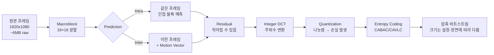

> **2026-10-29 정정** — raw 단위·압축 비율·매크로블록 올림·GOP 계산을 수정했습니다. 근거 없는 고정 화질·성능 수치는 철회하고 계산 예시와 측정이 필요한 항목을 구분했습니다.


1080p 60fps를 **RGB 8비트 × 3채널, 패딩 없는 raw 영상**으로 계산하면 1920 × 1080 × 3 × 60 = **373,248,000바이트/초**, 즉 **373.248MB/s**다. 1시간은 약 1.344TB다. 여기서 MB·TB는 10진 단위다.

비교할 인코딩 비트레이트를 **6Mbps로 가정**하면 6,000,000 ÷ 8 = **750,000바이트/초 = 0.75MB/s**. 두 데이터율의 비는 **497.664배, 약 498배**다. 오디오와 컨테이너 오버헤드는 제외했다.

이 값은 두 표현의 데이터율 비교다. H.264가 모든 영상을 같은 화질로 498배 압축한다는 뜻이 아니다. raw를 8비트 YUV 4:2:0으로 잡으면 186.624MB/s라 비교 비율도 약 249배로 바뀐다. 손실 압축 결과는 장면과 인코더 설정으로 따로 평가해야 한다.


{"tooltip":{"trigger":"axis"},"grid":{"left":"18%","right":"8%","bottom":"15%"},"xAxis":{"type":"category","data":["RGB 24bit raw","YUV 4:2:0 8bit raw","6Mbps 출력 가정"]},"yAxis":{"type":"value","name":"MB/s"},"series":[{"type":"bar","data":[373.248,186.624,0.75],"label":{"show":true,"position":"top"},"itemStyle":{"color":"#087f8b"}}]}


[지난 글](../whip-whep-modern-ingest/)에서 스트리밍 프로토콜(RTMP/HLS/WebRTC/WHIP)을 정리했다면, 이번 글은 **그 안에 흐르는 영상 데이터가 어떻게 만들어지는지** 정리한 노트다. I/P/B 프레임, 매크로블록, 양자화, CABAC, NAL Unit, 그리고 OBS 인코딩 옵션의 진짜 의미.

---

## 1. H.264의 정체 — 두 표준 단체가 공동으로 만든 결과

H.264는 ITU-T와 ISO/IEC가 공동으로 표준화한 영상 부호화 규격이다. AVC, ISO/IEC 14496-10이라는 이름으로도 부른다. 첫 권고는 2003년에 나왔다. 라이브·녹화 환경에서 널리 쓰이지만, 이 글에는 시장 점유율을 산출할 자료가 없다.

## 2. 압축의 3가지 원리 — 어디서 데이터를 줄이나

H.264는 영상의 **중복성**을 세 가지 방식으로 활용한다.

| 종류 | 원리 | 예시 |
|---|---|---|
| **공간적 중복** | 한 프레임 안에서 인접 픽셀이 비슷함 | 하늘은 거의 같은 파란색 |
| **시간적 중복** | 연속 프레임이 거의 같음 | 정적인 배경 |
| **통계적 중복** | 자주 나오는 값에 짧은 코드 부여 | 0이 많이 나옴 → 0에 1비트 |

각 중복을 다른 기법으로 압축. **공간 → Intra Prediction**, **시간 → Inter Prediction + Motion Vector**, **통계 → CABAC/CAVLC**.

---

## 3. I/P/B 프레임 — H.264의 압축 핵심


*그림은 예측 관계를 설명하는 도식이다. 프레임별 바이트 수와 비율은 고정값이 아니다.*

| 구분 | 사용하는 예측 | 읽을 때 주의할 점 |
|---|---|---|
| I | 같은 영상 안의 공간 예측 | raw 이미지 저장과 다르다 |
| P | 참조 영상 목록을 이용한 예측 | 이전에 복호한 참조 영상이 필요하다 |
| B | 두 참조 목록을 이용한 예측 | 표시 순서와 복호 순서가 다를 수 있다 |

실제 문법은 슬라이스 단위다. I/P/B를 프레임 전체의 성격으로 부르는 것은 설명을 단순화한 표현이다. **I 영상과 IDR은 같은 말이 아니다.** IDR은 뒤의 영상이 IDR 이전 영상을 참조하지 않도록 하는 경계다. 중간 진입과 독립 재생을 설명할 때 이 차이가 중요하다.

### Motion Vector — P/B 프레임의 작동 원리

P-frame이 이전 프레임의 모든 픽셀을 다시 저장하지 않는 비밀.

```
[P-frame의 표현]
"이전 프레임 (10, 20) 위치의 16x16 블록을 가져와서
 (0, -5)만큼 이동시켜라 + 작은 차분"

→ 모션 벡터 (Δx=0, Δy=-5) + residual data (작음)
```

장면이 정적이면 모션 벡터 거의 0. 액션 장면이면 큰 값. 같은 해상도라도 움직임·질감·노이즈에 따라 필요한 비트레이트가 달라지는 이유다. 차이를 고정된 배수로 말할 수는 없다.

### GOP 크기의 트레이드오프

키프레임을 자주 넣으면 중간 진입과 탐색을 위한 경계가 늘지만, 같은 비트레이트에서 압축 효율이 나빠질 수 있다. 긴 GOP는 그 반대의 비용을 가진다. 정확한 탐색은 필요한 앞선 참조부터 복호하는 방식으로도 가능하다.

HLS에 **6초 GOP가 강제되는 것은 아니다**. 세그먼트 목표 길이, 키프레임 간격, 독립 세그먼트 조건을 함께 맞춘다. 60fps 출력에서 2초 간격은 120프레임이다. [HLS 규격](https://www.rfc-editor.org/rfc/rfc8216.html)의 독립 세그먼트 조건과 플레이어의 요구를 확인해야 한다.

## 4. H.264 인코딩 5단계 파이프라인

I/P/B 프레임을 만드는 실제 과정.




### Stage 1: Macroblock 분할

프로그레시브 1920 × 1080 영상을 16 × 16 단위로 덮으려면 다음과 같이 올림한다.

```text
가로: ceil(1920 / 16) = 120
세로: ceil(1080 / 16) = 68
합계: 120 × 68 = 8,160 매크로블록
부호화 높이 1,088에서 표시 영역 1,080으로 크롭
```

예측과 변환에는 더 작은 분할도 쓰인다. 모든 연산이 16 × 16 한 단위로만 이루어진다는 뜻은 아니다.

### Stage 2: Prediction — 압축의 진짜 비밀

각 매크로블록에 대해 **이미 처리된 부분**(같은 프레임의 인접 블록 OR 이전 프레임의 비슷한 블록)으로 예측.

```
실제 블록    예측 블록    차분(residual)
[123 124   ]   [122 123   ]   [+1 +1   ]
[125 126   ]   [124 125   ]   [+1 +1   ]
...            ...            ...
```

예측이 잘 맞을수록 차분이 작아진다. 복잡한 장면에서는 큰 잔차가 남을 수 있다.

### Stage 3: Integer DCT — 주파수 변환

차분을 **주파수 도메인**으로 변환. DCT 비슷한 정수 변환(Integer DCT). 영상의 큰 패턴은 저주파, 디테일은 고주파.

```
공간 도메인          주파수 도메인
[+1 +1 +1 +1]       [+4  0  0  0]  ← 저주파에 집중
[+1 +1 +1 +1]   →   [ 0  0  0  0]
[+1 +1 +1 +1]       [ 0  0  0  0]
[+1 +1 +1 +1]       [ 0  0  0  0]
```

이 예시는 일정한 잔차가 저주파에 집중되는 경우다. 모든 입력의 변환 계수가 이렇게 나오는 것은 아니다.

### Stage 4: Quantization — 손실 압축의 본질

변환 계수를 더 거친 단계로 표현하면 정보를 잃는 대신 0과 작은 계수가 많아질 수 있다.

```text
설명용 균일 양자화: 단계 크기를 10으로 가정하고 최근접 반올림
40 / 10 → 4 → 복원 40
 8 / 10 → 1 → 복원 10
 3 / 10 → 0 → 복원  0
```

**위 나눗셈은 H.264의 QP=10을 뜻하지 않는다.** 실제 양자화에는 스케일링과 반올림 규칙이 있고, QP와 단계 크기는 선형 관계가 아니다. QP 6 증가에 단계 크기가 대략 2배가 되는 관계를 사용한다.

QP별 압축 배수나 “모바일 화질”이 정해져 있지도 않다. x264의 CRF는 일정 비트레이트를 지정하는 모드가 아니라 품질 목표에 따라 양자화를 조절하는 방식이며, 같은 CRF라도 결과는 콘텐츠에 따라 달라진다.

### Stage 5: Entropy Coding — 무손실 압축 마무리

양자화 뒤의 문법 요소를 엔트로피 부호화한다. CAVLC와 CABAC은 압축 효율과 연산량이 다르며, 사용할 수 있는 방식은 프로파일의 제약을 받는다. CABAC을 켜면 항상 10% 줄어든다는 보장은 없다. 실제 입력과 인코더 설정으로 비교해야 한다.

## 5. Profile과 Level — H.264의 두 축

각자 다른 걸 제한.

### Profile — 기능 집합

| Profile | 기능 | 호환성 | 사용처 |
|---|---|---|---|
| **Baseline** | 기본 (I/P만) | 최고 (피처폰) | 옛 모바일 |
| **Main** | + B-frame, CABAC | 좋음 | 일반 라이브 |
| **High** | + 8x8 transform, 가변 양자화 | 약간 제한적 | VOD, 고화질 |
| **High 10** | + 10-bit | 제한적 | HDR |

High Profile은 흔한 선택이지만 보편적인 호환성 보장은 아니다. 대상 기기의 프로파일·레벨·비트 심도 지원을 확인한다.

### Level — 처리 부담 상한

레벨은 단일한 “최대 해상도” 표가 아니다. 영상당 매크로블록 수, 초당 처리량, 디코딩 버퍼, 비트레이트 등에 상한을 둔다. 비트레이트 한도는 프로파일에도 영향을 받는다.

1080p60을 다룰 때 Level 4.2를 검토할 수 있지만, 레벨을 선언했다고 인코더 출력이나 모든 디코더가 그 조건을 만족하는 것은 아니다. 실제 스트림과 대상 기기를 확인해야 한다.

### 코덱 문자열 — `avc1.640028` 해부

브라우저에서 `MediaSource.isTypeSupported('video/mp4; codecs="avc1.640028"')` 같은 거 봤을 거다.

```
avc1.640028
└─┬─┘ │ │ │
   │  │ │ └── 28 = Level 4.0 (decimal 40, 16진수 28)
   │  │ └──── 00 = Constraint flags
   │  └────── 64 = Profile (decimal 100 = High Profile)
   └──────── avc1 = H.264 (AVC)

→ "H.264 High Profile Level 4.0"
```

매니페스트(M3U8/MPD)에 박혀있어서 플레이어가 미리 디코딩 가능 여부 판단.

---

## 6. NAL Unit — 비트스트림의 단위

압축된 H.264 데이터는 **NAL Unit (Network Abstraction Layer Unit)** 의 연속.

### NAL Unit 헤더 (1바이트)

```
 7 6 5 4 3 2 1 0
┌─┬─┬─┬─┬─┬─┬─┬─┐
│F│NRI│  Type   │
└─┴─┴─┴─┴─┴─┴─┴─┘
F   = Forbidden (0 강제)
NRI = Reference Idc (참조 중요도)
Type = NAL Unit 종류 (5비트)
```

### 주요 NAL Unit Type

| Type | 이름 | 의미 |
|---|---|---|
| 1 | Non-IDR Slice | IDR이 아닌 부호화 슬라이스; I 슬라이스도 가능 |
| 5 | IDR Slice | 참조 관계를 끊는 IDR 영상의 슬라이스 |
| 6 | SEI | 보조 정보 (HDR 메타데이터 등) |
| 7 | **SPS** | Sequence Parameter Set |
| 8 | **PPS** | Picture Parameter Set |
| 9 | AUD | Access Unit Delimiter |

### SPS / PPS — 디코더의 설정값

```
SPS (Sequence Parameter Set):
- 해상도, fps, bit depth, profile, level
- 초기화에 필요하며 스트림 안에서 반복되거나 갱신될 수 있음

PPS (Picture Parameter Set):
- 엔트로피 코딩 모드 (CABAC/CAVLC), 양자화 초기값
- 영상 전체 또는 일부에 적용
```

디코더는 해당 슬라이스가 참조하는 SPS/PPS를 먼저 알아야 한다. 이 정보는 비트스트림 안에서 오거나 MP4 초기화 정보처럼 별도로 전달될 수 있다. 중간 진입에는 필요한 설정과 복호 가능한 진입점이 모두 필요하다.

### Annex B vs AVCC — 두 가지 포맷

같은 NAL Unit을 두 가지 방식으로 표현.

```
[Annex B - MPEG-TS 등의 바이트 스트림 표현]
00 00 00 01 [NAL Unit 1] 00 00 00 01 [NAL Unit 2] ...
└──┬──┘                  └──┬──┘
Start Code               Start Code

[AVCC - MP4, fMP4에서 사용]
[Length (설정된 길이)] [NAL Unit 1] [Length (설정된 길이)] [NAL Unit 2] ...
```

HLS의 .ts는 Annex B, fMP4는 AVCC. **hls.js의 transmuxing이 이 변환을 한다**.

---

## 7. 인코더 옵션 — 실전 튜닝

### x264 preset — 속도 vs 화질

preset은 인코더가 사용할 탐색과 압축 도구의 조합이다. 느린 preset이 더 많은 계산으로 압축 효율을 개선할 수 있지만, 동일 CRF의 파일 크기나 VMAF가 일정한 비율로 변하는 것은 아니다.

기존의 preset별 VMAF·속도 그래프는 원본 영상과 실행 조건이 없어 철회했다. 이 글의 그래프는 앞부분의 raw 데이터율 계산으로 교체했다. 라이브에서는 입력 해상도·fps를 지속적으로 처리할 수 있는지 측정하고, 그 안에서 품질과 비용을 비교한다.

### Tune — 콘텐츠별 최적화

| Tune | 용도 |
|---|---|
| `film` | 영화 (필름 노이즈 유지) |
| `animation` | 애니메이션 (큰 단색 영역) |
| `grain` | 필름 그레인 보존 |
| `stillimage` | 슬라이드쇼 |
| `psnr` / `ssim` | 측정값 최적화 |
| **`zerolatency`** | **라이브 (B-frame 비활성, lookahead 0)** |

`zerolatency`는 재정렬과 선행 탐색 대기를 줄이는 선택이다. 압축 효율의 비용이 있어 모든 라이브에 강제하지 않는다. 줄어드는 시간도 fps와 기존 설정에 따라 다르다.

### 비트레이트 제어 모드

```bash
# CRF — 품질 목표 기반, 비트레이트는 콘텐츠에 따라 가변
ffmpeg -c:v libx264 -crf 23 ...
# CRF 숫자를 보편적인 화질 등급으로 해석하지 않는다

# 비트레이트/VBV 제약 예시 — 이 옵션만으로 모든 순간의 전송량이 일정해지지는 않음
ffmpeg -c:v libx264 -b:v 6000k -minrate 6000k -maxrate 6000k -bufsize 12000k ...
# muxer·padding·측정 구간까지 포함해 실제 전송률을 확인한다

# VBR (Variable Bit Rate) — 평균 일정, 순간 가변
ffmpeg -c:v libx264 -b:v 6000k -maxrate 12000k -bufsize 24000k ...
# VOD에서 가끔
```

### 라이브 인코딩 표준 명령

```bash
ffmpeg -i input \
  -c:v libx264 \
  -preset veryfast \
  -tune zerolatency \
  -profile:v high \
  -level 4.2 \
  -pix_fmt yuv420p \
  -b:v 6000k -minrate 6000k -maxrate 6000k -bufsize 12000k \
  -r 60 -g 120 -keyint_min 120 \
  -sc_threshold 0 \
  -f flv rtmp://...
```

위 명령은 1080p 입력을 60fps로 출력한다는 구성 예시이며, 실행 벤치마크가 아니다.

각 옵션의 의미:
- `preset veryfast`: 실시간 인코딩
- `tune zerolatency`: B-frame 끔, 지연 최소화
- `profile:v high -level 4.2`: 출력의 프로파일과 레벨 선언; 입력 크기와 실제 제약 확인 필요
- `pix_fmt yuv420p`: 8비트 4:2:0 출력; 대상 플레이어의 지원은 별도 확인
- `r 60 -g 120`: 60fps 출력에서 최대 120프레임, 즉 2초 GOP
- `sc_threshold 0`: scene change에 의한 자동 키프레임 비활성 (GOP 일정 유지)

---

## 8. 화질 평가 — PSNR vs SSIM vs VMAF

PSNR은 픽셀 오차, SSIM은 구조적 유사성, VMAF는 여러 특징을 결합한 학습 모델로 품질을 평가한다. 서로 다른 관점을 제공하므로 하나의 점수로 모든 화질을 판정하지 않는다.

**PSNR 40dB나 VMAF 90이 무손실을 보장하지 않는다.** 해상도, 스케일링, 정렬, VMAF 모델과 버전, 시청 환경을 함께 기록해야 한다. 원본과 테스트 영상의 대응이 잘못되면 비교 자체가 무의미해진다. 육안 검토도 함께 한다.

## 9. Two-pass 인코딩 — 화질 짜내기

입력을 먼저 분석할 수 있는 파일 인코딩에서는 1차 통계로 2차 비트 배분을 계획할 수 있다. 다음은 목표 평균 비트레이트를 쓰는 x264 예시다.

```bash
ffmpeg -i input.mp4 -an -c:v libx264 -b:v 6000k -pass 1 -f null /dev/null
ffmpeg -i input.mp4 -c:v libx264 -b:v 6000k -pass 2 output.mp4
```

VMAF가 고정적으로 2~3점 상승하거나 실행 시간이 정확히 두 배가 되는 것은 아니다. CRF와 2-pass 평균 비트레이트 제어도 서로 구분한다. 아직 도착하지 않은 미래 입력 전체를 미리 분석하는 방식은 라이브에 그대로 적용할 수 없다.

## 정리하면

핵심은 **표현 조건, 예측 관계, 양자화, 실제 출력 검증**을 구분하는 것이다. raw 데이터율은 계산할 수 있지만 압축 후 화질과 속도는 측정해야 한다. 60fps에서 2초 GOP는 120프레임이며, I 영상과 IDR은 다르다. `avc1.640028`은 High Level 4.0이고 Level 4.2라면 끝이 `2a`다.

다음 [H.265 글](../h265-hdr-deep-dive/)에서는 압축 도구와 호환성, 라이선스 검토를 구분한다.

**참고**
- [ITU-T H.264](https://www.itu.int/rec/T-REC-H.264)
- [FFmpeg libx264 옵션](https://ffmpeg.org/ffmpeg-codecs.html#libx264_002c-libx264rgb)
- [x264](https://www.videolan.org/developers/x264.html)
- [Netflix VMAF](https://github.com/Netflix/vmaf)
