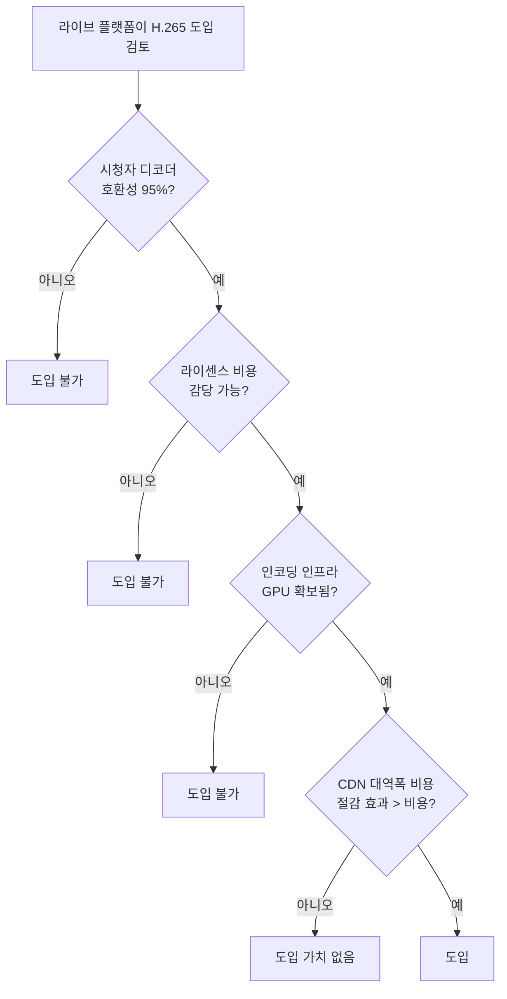

> **2026-10-29 정정** — 시장 점유율·디바이스 지원율·공통 0.5% 로열티·플랫폼별 채택 이유를 철회했습니다. 라이선스 프로그램의 현재 공식 안내를 연결했고, 남은 성능 그래프는 실측 근거 미확인으로 표시했습니다.


H.265(HEVC)는 H.264보다 발전한 압축 도구를 제공한다. 실제 비트레이트 절감률과 인코딩 비용은 콘텐츠·설정·구현에 따라 달라진다. 보급률 1%나 항상 50% 절감처럼 단일 숫자로 일반화할 근거는 이 글에 없다.

선택에는 플레이어 호환성, 하드웨어 지원, 특허 라이선스와 운영 비용이 함께 영향을 준다. 특정 플랫폼의 채택 이유나 비공개 계약을 확인한 것처럼 설명하지 않는다. 이 글은 HEVC와 HDR의 구성 요소를 살펴보는 학습 노트다.

---

## 1. 4K에서 검토할 비트레이트 예산

H.264의 한계가 명확해지는 지점이 4K.

```
1080p H.264: 6 Mbps (OK)
1440p H.264: 12 Mbps (살짝)
4K (2160p) H.264: 25~40 Mbps (시청자 대역폭 부담)
8K H.264: 100 Mbps+ (불가능)
```

위 비트레이트는 예시 범위이며 해상도만으로 필요한 전송률을 확정할 수 없다. 시청 가능 비율은 실제 사용자 네트워크 분포로 평가해야 한다.

---

## 2. H.265의 등장 — 2013년

ITU-T + ISO/IEC가 H.264 만들 때처럼 또 공동 작업.

```
공식 명칭:
- ITU-T H.265 (2013년 4월)
- ISO/IEC 23008-2 (MPEG-H Part 2)
- 통칭 HEVC (High Efficiency Video Coding)
```

### H.265가 H.264보다 좋은 이유

| 항목 | H.264 | H.265 |
|---|---|---|
| 매크로블록 크기 | 16×16 고정 | 64×64 가변 (CTU) |
| 인트라 예측 모드 | 블록 크기에 따라 다름 | 33개 각도 + planar·DC, 총 35개 |
| 모션 벡터 정밀도 | 1/4 픽셀 | 1/4 픽셀 + 향상 |
| 엔트로피 코딩 | CABAC/CAVLC | **CABAC 개선** |
| 같은 화질 비트레이트 | 비교 기준 | 원본·인코더·설정·평가 방법을 맞춰 측정 |
| 4K 처리 | 부적합 | **표준** |
| HDR | 비표준 | **공식 표준 (Main10)** |

핵심은 **CTU (Coding Tree Unit)** — 16×16 매크로블록 대신 64×64까지 가변 분할. 큰 평면 영역을 한 번에 처리해서 효율 폭증.

---

## 3. 라이선스의 적용 범위 확인

HEVC의 특허 라이선스는 적용 제품·사업 모델·지역·계약에 따라 검토해야 한다. 예전의 “3개 풀” 설명이나 콘텐츠 매출 0.5%를 모든 서비스에 적용하는 계산은 부정확해 철회했다.

[Via Licensing Alliance의 공식 안내](https://www.via-la.com/licensing-programs/hevc-vvc/)는 2025년 12월 15일 Access Advance가 해당 HEVC/VVC 프로그램을 인수했다고 설명한다. 프로그램 구성도 고정되어 있지 않다. 최신 범위는 [Access Advance의 라이선스 대상 안내](https://accessadvance.com/topic-what-do-we-license/)에서 확인해야 한다.

<details><summary>이전 설명 그림 보관 — 현재 라이선스 안내로 사용하지 않음</summary>


</details>

### 비용 예시

시청자 1억 명을 디바이스 판매 대수와 동일하게 취급해 라이선스 비용을 계산할 수 없다. 이전의 $10M 대 $55M 비교는 적용 계약이 확인되지 않아 철회했다. 제품·서비스의 적용 범위와 계약 조건이 정해져야 비용을 산정할 수 있다.

### 특정 기업의 선택과 계약을 구분하기

외부에서 비공개 라이선스 계약이나 내부 의사결정의 단일 원인을 단정하지 않는다. 특정 디바이스의 라이선스가 서비스의 모든 의무를 자동으로 해결한다고도 가정하지 않는다. 기술적으로는 대상 기기의 HEVC·HDR 지원, 품질과 전송량의 균형을 함께 검토할 수 있다.

## 4. 인코딩 비용 — H.264 대비 큰 부담

라이센스가 없어도 인코딩 자체가 무겁다.

```
[같은 화질 인코딩 시간 — x265 medium 기준]
x264 medium: 1x (기준)
x265 medium: 4~6x 느림
```

라이브 1080p60을 x265 medium으로 못 함. 가능한 옵션:

```bash
# CPU 인코딩 (느림)
ffmpeg -i input -c:v libx265 -preset veryfast \
  -tag:v hvc1 -crf 28 output.mp4

# GPU 인코딩 (NVENC, 빠름)
ffmpeg -i input -c:v hevc_nvenc -preset p4 \
  -tag:v hvc1 -b:v 4000k output.mp4
```

NVENC는 H.265를 H.264와 비슷한 속도로 인코딩. **4K 라이브는 GPU 강제**.

`-tag:v hvc1` 옵션이 중요. 다음 섹션에서 설명.

---

## 5. hvc1 vs hev1 — iOS 호환의 함정

같은 H.265 영상도 컨테이너 태그가 두 가지.

| 태그 | 의미 | iOS Safari 호환 |
|---|---|---|
| `hvc1` | Out-of-band 파라미터 | ✅ |
| `hev1` | In-band 파라미터 | ❌ |

```bash
# 올바른 명령 (iOS 호환)
ffmpeg ... -c:v libx265 -tag:v hvc1 output.mp4

# 잘못된 명령 (iOS Safari 재생 안 됨)
ffmpeg ... -c:v libx265 output.mp4
# 기본 태그 hev1로 박힘
```

이걸 모르고 H.265 인코딩한 결과 iOS에서 안 나오는 경우가 정말 많음. **`-tag:v hvc1` 무조건 명시**.

H.265 코덱 문자열:

```
hvc1.1.6.L120.B0
└──┘ │ │  │    │
  │  │ │  │    └── B0 = constraint flags
  │  │ │  └─────── L120 = Level 4.0
  │  │ └────────── 6 = Profile compatibility
  │  └──────────── 1 = Profile (Main)
  └─────────────── hvc1 = H.265 hvc1 tag
```

---

## 6. Profile/Level

H.264와 비슷한 구조.

| Profile | 용도 |
|---|---|
| **Main** | 일반 (8-bit 4:2:0) |
| **Main 10** | **HDR (10-bit 4:2:0)** |
| **Main 4:2:2 10** | 프로덕션 |
| **Main 4:4:4 12** | 최고 품질 |

HDR을 하려면 **무조건 Main 10**.

Level은 H.264와 동일한 4K/8K 처리 능력 매트릭스. 4K 60fps는 Level 5.1.

---

## 7. HDR이 정확히 뭔가

HDR (High Dynamic Range) = "더 밝고 더 어두운 영역을 동시에 표현". 그런데 **이게 시각적으로 무엇을 의미하는지**가 진짜 핵심.


```
[SDR (Rec.709, 8-bit, 100 nits 기준)]
- 최대 밝기: 100 nits
- 색공간: Rec.709 (Full HD TV 표준)
- 색심도: 8-bit (1670만 색)
- 결과: 태양은 하얀 덩어리로 클리핑, 그림자는 검은 덩어리, 그라데이션에 banding

[HDR (Rec.2020, 10-bit, 1000 nits)]
- 최대 밝기: 1000+ nits (10배)
- 색공간: Rec.2020 (4K HDR 표준)
- 색심도: 10-bit (10억 색)
- 결과: 태양의 디테일, 그림자 텍스처, 부드러운 그라데이션
```

**"HDR = 더 밝음"이 아니라 "더 넓은 표현 범위"**. 같은 영상의 같은 일출 장면을 SDR과 HDR로 보면 완전히 다른 영상처럼 보임.

### HDR의 4가지 표준

| 표준 | 메타데이터 | 라이센스 | 용도 |
|---|---|---|---|
| **HDR10** | 정적 (영상 전체에 1세트) | 무료 | **표준 HDR** (Netflix, Disney+, YouTube) |
| **HDR10+** | 동적 (장면별 다름) | 무료 | Amazon Prime, Samsung |
| **HLG** (Hybrid Log-Gamma) | 없음 | 무료 | **방송, 라이브** (BBC, NHK) |
| **Dolby Vision** | 동적 + 12-bit | 비쌈 | **프리미엄** (Netflix, Apple TV+) |

```
[선택 기준]
호환성 + 무료: HDR10
프리미엄 화질: Dolby Vision
라이브 방송: HLG
```

### 왜 HLG가 라이브에 적합

HDR10/HDR10+/Dolby Vision은 **메타데이터** 필요. 영상 인코딩 시 "이 영상의 최대 밝기는 1000 nits" 같은 정보를 박아야 함. 전체 영상을 분석한 후 결정해야 해서 라이브에 부적합.

HLG는 메타데이터 없음. **신호 자체에 HDR 정보가 인코딩**됨. 라이브 송출 시 그냥 보내면 됨. 디바이스가 자동 디코딩.

BBC가 4K HDR 올림픽 중계할 때 HLG.

---

## 8. 10-bit 색심도 — HDR의 필수 조건

H.265 Main 10 Profile이 필수인 이유.

```
8-bit:  2^8 = 256 단계
10-bit: 2^10 = 1024 단계 (4배)

색 (RGB):
8-bit: 256³ = 1670만 색
10-bit: 1024³ = 10억 색 (64배)
```

HDR 그라데이션이 부드러운 진짜 이유: **8-bit로는 banding 불가피, 10-bit는 매끄러움**.

해 지는 하늘의 그라데이션을 8-bit로 표현하면 색이 띠처럼 끊겨 보임 (banding). 10-bit로는 자연스러움.

```bash
# 10-bit 인코딩
ffmpeg -i input -c:v libx265 -pix_fmt yuv420p10le \
  -tag:v hvc1 -profile:v main10 output.mp4
```

`pix_fmt yuv420p10le`가 10-bit YUV. 8-bit는 `yuv420p`.

---

## 9. Chroma Subsampling — 왜 4:2:0이 표준인가

영상 압축의 중요한 트릭. 사람 눈의 한계를 활용.


```
사람 눈의 특성:
- 명도(밝기, Luma) 감지 ≫ 색상(Chroma) 감지
- 명도는 픽셀 단위로 인식
- 색은 인접 픽셀과 평균으로 인식
```

이걸 이용해서 **색 정보를 줄여도 사람이 못 알아챈다**.

| 형식 | 명도 (Y) | 색 (Cb, Cr) | 데이터 크기 |
|---|---|---|---|
| **4:4:4** | 모든 픽셀 | 모든 픽셀 | 100% (기준) |
| **4:2:2** | 모든 픽셀 | 2픽셀당 1 | 67% |
| **4:2:0** | 모든 픽셀 | **2×2 블록당 1** | **50%** |

**4:2:0이 스트리밍 표준**. HLS, YouTube, Netflix 다 4:2:0. 색 정보를 50% 버리지만 시청자는 차이 거의 못 느낌.

`-pix_fmt yuv420p` (8-bit 4:2:0) 또는 `yuv420p10le` (10-bit 4:2:0)가 모든 스트리밍에서 기본.

---

## 10. H.265의 디코딩 측 — 시청자 디바이스 호환성

운영체제 버전만으로 HEVC 재생 가능 여부를 결정할 수 없다. 하드웨어, 브라우저, 코덱 프로파일과 비트 심도, 컨테이너와 DRM 조합을 함께 확인한다.

기존의 “Android 95%, Chrome 70%” 표는 모집단과 조사 자료가 없어 제거했다. 대상 사용자군에서 기능 탐지와 실제 재생 시험, 재생 실패율을 수집해야 도달률을 평가할 수 있다.

## 11. 라이브 HEVC의 도입 조건



위 흐름은 검토 순서를 설명한다. 95%는 가상의 정책 기준이며 산업 공통 기준이 아니다. 부분 도입과 대체 코덱 제공도 선택지다.

### 서비스별 지원 현황을 확인하는 방법

서비스별 지원은 시점·기기·플랜·송출과 시청 구간에 따라 달라진다. 기존의 단순 O/X 표는 최신 공식 지원 문서와 연결되지 않아 철회했다. 도입 판단에는 대상 서비스의 현재 공식 인코딩·재생 요구를 확인해야 한다.

## 12. 4K HDR 인코딩의 옵션 예시

Netflix의 실제 명령이나 업계 공통 설정을 확인한 것이 아닌 옵션 설명용 예시다. 입력은 이미 BT.2020/PQ로 준비되어 있다고 가정하며, 색 메타데이터를 붙이는 것만으로 픽셀을 변환하거나 Dolby Vision을 올바르게 변환할 수는 없다. mastering-display·MaxCLL·MaxFALL은 실제 마스터와 콘텐츠에서 확인해야 한다.

```bash
# Per-Title Encoding 분석 후
ffmpeg -i master_4k_dolby_vision.mov \
  -c:v libx265 \
  -preset slow \
  -tag:v hvc1 \
  -profile:v main10 \
  -pix_fmt yuv420p10le \
  -x265-params "colorprim=bt2020:transfer=smpte2084:colormatrix=bt2020nc:hdr-opt=1:repeat-headers=1:master-display=G(13250,34500)B(7500,3000)R(34000,16000)WP(15635,16450)L(10000000,1):max-cll=1000,400" \
  -b:v 15M -maxrate 18M -bufsize 36M \
  -c:a eac3 -b:a 768k \
  output_4k_hdr10.mp4
```

각 옵션의 의미:
- `colorprim=bt2020`: Rec.2020 색공간
- `transfer=smpte2084`: PQ (Perceptual Quantizer, HDR10 표준)
- `master-display`: 마스터 모니터의 사양 (메타데이터)
- `max-cll=1000,400`: 최대 콘텐츠 밝기 / 평균 (메타데이터)

입력의 색 표현과 실제 측정 메타데이터, 출력 장치 지원을 대조해 설정해야 한다. 이 예시를 특정 기업의 운영 파이프라인으로 인용하지 않는다.

---

## 13. 라이브 4K HDR — HLG로

올림픽급 라이브.

```bash
ffmpeg -i camera_input \
  -c:v hevc_nvenc \
  -preset p4 \
  -tag:v hvc1 \
  -profile:v main10 \
  -pix_fmt yuv420p10le \
  -tune ll \
  -rc cbr \
  -b:v 30M -maxrate 30M -bufsize 60M \
  -color_primaries bt2020 \
  -color_trc arib-std-b67 \
  -colorspace bt2020nc \
  -g 60 \
  -c:a aac -b:a 192k \
  -f flv rtmp://...
```

핵심:
- `hevc_nvenc`: 전용 엔진 인코딩; CPU·GPU 모두 입력과 설정별 지속 처리량을 측정
- `color_trc arib-std-b67`: HLG transfer (라이브용)
- 메타데이터 없음 (HLG 특징)

BBC 4K HDR 올림픽 송출이 이런 셋업.

---

## 14. ABR Ladder for 4K HDR

| 화질 | 코덱 | 비트레이트 | HDR | 비고 |
|---|---|---|---|---|
| 4K HDR | H.265 Main10 | 25 Mbps | HDR10 | 프리미엄 시청자 |
| 4K SDR | H.265 Main | 18 Mbps | SDR | 호환성 |
| 1080p HDR | H.265 Main10 | 10 Mbps | HDR10 | 모바일 HDR |
| 1080p SDR | H.264 | 6 Mbps | SDR | 일반 |
| 720p | H.264 | 3 Mbps | SDR | 모바일 |
| 480p | H.264 | 1.5 Mbps | SDR | 데이터 절약 |

같은 콘텐츠를 6단계로 인코딩. 시청자 디바이스/네트워크에 따라 자동 선택.

H.265 인코딩 비용 + H.264 인코딩 비용 둘 다 부담. **OTT 인프라 비용 증가의 큰 요인**.

---

## 15. 트랜스코딩 비용 비교


{
  "tooltip": { "trigger": "axis" },
  "grid": { "left": "20%", "right": "10%", "bottom": "12%", "top": "8%" },
  "xAxis": {
    "type": "value",
    "name": "트랜스코딩 시간 (분)"
  },
  "yAxis": {
    "type": "category",
    "data": ["AV1 (svt-av1, CPU)", "H.265 (x265 medium)", "H.265 (NVENC)", "H.264 (NVENC)"]
  },
  "series": [{
    "type": "bar",
    "data": [
      { "value": 360, "itemStyle": { "color": "#ef4444" } },
      { "value": 240, "itemStyle": { "color": "#f59e0b" } },
      { "value": 12, "itemStyle": { "color": "#3b82f6" } },
      { "value": 6, "itemStyle": { "color": "#10b981" } }
    ],
    "label": { "show": true, "position": "right", "formatter": "{c}분" }
  }]
}


GPU 인코딩 (NVENC) 없이는 H.265 도입 불가. 4K 1시간을 4시간 동안 인코딩하는 건 라이브에선 의미 없음.

---

## 16. iPhone HDR 영상의 처리 — 실무 케이스

iPhone 12+ 부터 4K Dolby Vision HDR 녹화. 이걸 일반 웹에 올리려면 변환 필수.

```bash
# iPhone HDR → HDR10 (Netflix 같은 OTT용)
ffmpeg -i iphone_hdr.mov \
  -c:v libx265 -tag:v hvc1 \
  -profile:v main10 -pix_fmt yuv420p10le \
  -x265-params "colorprim=bt2020:transfer=smpte2084:colormatrix=bt2020nc:hdr-opt=1" \
  -b:v 15M \
  output_hdr10.mp4

# iPhone HDR → SDR (Twitter, Instagram 같은 일반 웹)
ffmpeg -i iphone_hdr.mov \
  -vf "zscale=t=linear:npl=100,format=gbrpf32le,zscale=p=bt709,tonemap=tonemap=hable:desat=0,zscale=t=bt709:m=bt709:r=tv,format=yuv420p" \
  -c:v libx264 -crf 23 \
  output_sdr.mp4
```

두 번째 명령의 `tonemap=hable`이 **HDR → SDR Tone Mapping**. HDR의 넓은 밝기 범위를 SDR의 좁은 범위에 압축. Hable 알고리즘이 표준.

Tone Mapping 안 하고 그냥 SDR 변환하면 영상이 어둡거나 색이 깨짐.

---

## 17. 한국 라이브 시장의 H.265

특정 국내 서비스가 HEVC를 전혀 쓰지 않거나 일부 4K에 쓴다는 기존 표는 공개 근거가 확인되지 않아 제거했다. 시장 전체가 한 번에 같은 코덱으로 전환한다고 가정하지 않는다.

## 정리하면

HEVC를 고를 때는 압축 효율, 실행 비용, 디코더 지원, HDR 신호와 라이선스 범위를 구분한다. 고정 절감률이나 확인되지 않은 시장 점유율로 결론을 내리지 않는다.

다음 [AV1·VP9 글](../av1-vp9-deep-dive/)에서도 라이선스 목표와 실제 적용 범위, 압축 실험의 조건을 구분해서 읽어야 한다.

**참고**
- [ITU-T H.265](https://www.itu.int/rec/T-REC-H.265)
- [Via HEVC/VVC 프로그램](https://www.via-la.com/licensing-programs/hevc-vvc/)
- [Access Advance 라이선스 대상](https://accessadvance.com/topic-what-do-we-license/)
